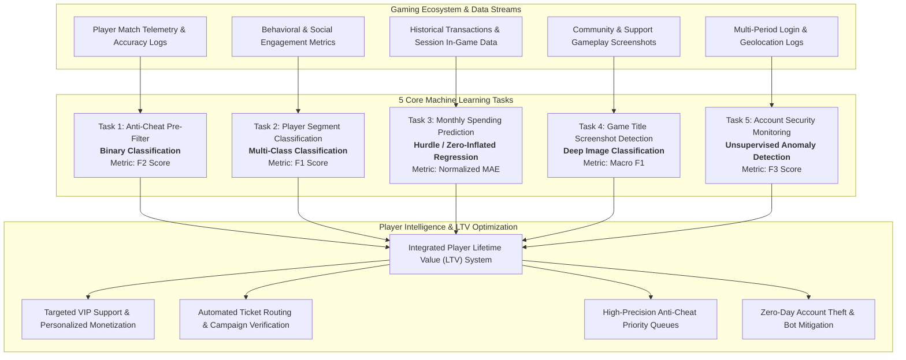

# CPE 342 Term Project: Karena Player Intelligence System

**Course:** CPE 342 Machine Learning (Semester 1/2026 Cohort)  
**Department:** Department of Computer Engineering, Faculty of Engineering, King Mongkut's University of Technology Thonburi (KMUTT)  
**Team:** ML004  
**Instructor & TAs:** Dr. Boonyarit Changaival, P’ Sun (papit.vieng@kmutt.ac.th), P’ Noinar (phanita.siri@kmutt.ac.th), P’ Chokun (chotanansub.soph@kmutt.ac.th)  
**Central Team GitHub Repository:** [`https://github.com/beambeambeam/ml00x`](https://github.com/beambeambeam/ml00x)  
**Kaggle Competition Page:** [`player-intelligence-system-cpe-342-ml`](https://www.kaggle.com/competitions/player-intelligence-system-cpe-342-ml/)

---

## 📖 Executive Summary & Industrial Background

**Karena Thailand** is a premier digital entertainment platform and game publisher operating across Southeast Asia (modeled after industry ecosystems such as *Garena*). The platform manages a diverse portfolio of flagship online titles across mobile, desktop, and multiplayer servers:
* **PUBE Mobile:** High-intensity tactical battle royale.
* **Free Fried:** Fast-paced competitive survival shooter.
* **7-11 Knights:** Fantasy character collection & tactical turn-based RPG.
* **Roblock:** User-generated sandbox multiplayer platform.
* **FiveN:** Roleplay & persistent community simulation.

### The Business Challenge
Operating at massive scale introduces critical operational and data challenges:
1. **Game Integrity Under Siege:** Over 10,000 daily cheat reports with manual review capacity capped at 500 cases/day. Subtle hacks (aimbot, wallhack) evade simple rule-based heuristics while innocent players suffer a 70% false positive rate, eroding competitive retention.
2. **Untargeted Marketing & Player Churn:** Generic promotional campaigns yield abysmal 2–5% conversion rates. Top 5% players (whales) generate 60% of total platform revenue, yet marketing messages fail to distinguish casual players, competitive grinders, social networkers, and big spenders.
3. **Financial Uncertainty & Revenue Forecasting:** Finance quarterly projections routinely deviate by 35–40% due to zero-inflated, highly skewed spending distributions. VIP customer support misallocates high-touch resources to low-value accounts while neglecting high-lifetime-value players.
4. **Customer Support Bottlenecks in Screenshot Routing:** 2,000 daily support tickets contain unlabelled gameplay screenshots. Support staff spend 10+ minutes per ticket manually deciphering which game is shown before routing to specialists.
5. **Account Takeover & Regional Exploits:** Over 5,000 monthly account theft incidents, bot farming networks, and VPN pricing arbitrage cost millions in revenue. Existing rule-based tripwires generate 60% false alarms on legitimate travelers while missing gradual anomaly patterns.

### The Engineering Mission
To resolve these bottlenecks, our team of ML engineers is tasked with building an end-to-end **AI-Powered Player Intelligence & Lifetime Value (LTV) System** comprising **5 interconnected machine learning models**.



---

## 🛠️ The 5 Core Machine Learning Tasks

| Task | Problem Description | ML Paradigm | Target Variable | Primary Metric | Actual Dataset Schema (`data/`) |
| :--- | :--- | :--- | :--- | :--- | :--- |
| **Task 1** | **Anti-Cheat Pre-Filter**<br/>Separate true cheaters (aimbot/wallhack) from false positives among flagged accounts. | Binary Classification | `is_cheater`<br/>(`0` = Legit, `1` = Cheater) | **$F_2$ Score**<br/>($F_2 = \frac{5PR}{4P+R}$, Macro & Binary) | `train.csv` ($104,000 \times 33$; $90,816$ labeled, $13,184$ `NaN` target), `test.csv` ($25,889 \times 32$), 31 float features. |
| **Task 2** | **Player Segment Classification**<br/>Classify players into 4 behavioral personas for targeted marketing. | Multi-Class Classification | `segment`<br/>(`0`=Casual, `1`=Grinder, `2`=Social, `3`=Whale) | **Macro $F_1$**<br/>($\frac{1}{4}\sum_{c=0}^3 F_{1,c}$) | `train.csv` ($104,000 \times 46$), `test.csv` ($25,889 \times 45$), 44 features (31 valid float + 3 explicit noise `random_metric_1..3` + 10 categorical). |
| **Task 3** | **Player Monthly Spending Prediction**<br/>Predict monetary expenditure (THB) over the next 30 days. | Zero-Inflated Regression | `spending_30d`<br/>(Continuous THB $\ge 0$; $48.12\%$ zeros) | **Normalized MAE**<br/>($\text{NMAE} = \frac{1}{1 + \sum|y-\hat{y}|/\sum y}$) | `train.csv` ($104,000 \times 34$), `test.csv` ($25,889 \times 33$), 32 float features (includes `segment` from Task 2). |
| **Task 4** | **Game Title Detection**<br/>Identify which Karena game is played from single screenshots. | Multi-Class Image Classification | `class` / `game_title`<br/>(5 games: `0`–`4`) | **Macro $F_1$**<br/>(Pre-trained allowed) | RGB screenshots ($230 \times 120$ / $200 \times 100$ px) via official Google Drive archive (`1C8csylbBo3Oab24ODGKPVom3_SDUJ_Qw`, 579 MB). |
| **Task 5** | **Account Security Monitoring**<br/>Flag account theft, bot farms, and VPN abuse without labeled data. | Unsupervised Anomaly Detection | `is_anomaly`<br/>(`0` = Normal, `1` = Anomalous) | **$F_3$ Score**<br/>($F_3 = \frac{10PR}{9P+R}$) | `test.csv` only ($25,889 \times 123$): **122 features** (29 longitudinal metrics across 4 periods `_1.._4` + 6 security flags). |

---

## 📐 Mathematical Formulation of Evaluation Metrics

### 1. General $F_\beta$ Measure (Tasks 1 & 5)
$$F_\beta = (1 + \beta^2) \frac{\text{Precision} \times \text{Recall}}{(\beta^2 \times \text{Precision}) + \text{Recall}} = \frac{(1 + \beta^2)\text{TP}}{(1 + \beta^2)\text{TP} + \beta^2 \text{FN} + \text{FP}}$$

* **Task 1 ($F_2$ Score, $\beta = 2$):** Recall is weighted **twice as important** as Precision. Catching real cheaters ($\text{FN} \to 0$) is prioritized over occasional false alarms passed to human verifiers.
  $$F_2 = 5 \cdot \frac{\text{Precision} \cdot \text{Recall}}{4\text{Precision} + \text{Recall}}$$
* **Task 5 ($F_3$ Score, $\beta = 3$):** Recall is weighted **three times as important** as Precision. Missing an account takeover or coordinated bot ring ($\text{FN}$) causes catastrophic economic loss, so high sensitivity is paramount.
  $$F_3 = 10 \cdot \frac{\text{Precision} \cdot \text{Recall}}{9\text{Precision} + \text{Recall}}$$

### 2. Macro $F_1$ Measure (Tasks 2 & 4)
For multi-class classification across $C$ classes ($C=4$ for Task 2, $C=5$ for Task 4):
$$F_{1, c} = 2 \cdot \frac{\text{Precision}_c \cdot \text{Recall}_c}{\text{Precision}_c + \text{Recall}_c}, \qquad \text{Macro } F_1 = \frac{1}{C}\sum_{c=1}^C F_{1, c}$$
Ensures performance is evaluated uniformly across rare segments (e.g. Whales) and low-sample screenshot classes.

### 3. Normalized Mean Absolute Error Score (Task 3)
$$\text{Relative MAE} = \frac{\sum_{i=1}^N |y_i - \hat{y}_i|}{\sum_{i=1}^N y_i} = \frac{\text{MAE}}{\bar{y}}, \qquad \text{NMAE Score} = \frac{1}{1 + \dfrac{\sum_{i=1}^N |y_i - \hat{y}_i|}{\sum_{i=1}^N y_i}} \in [0, 1]$$
Normalizes the absolute financial forecasting error relative to total baseline spending and maps it into $[0, 1]$ (where $1.0$ represents zero error) so it combines seamlessly into the Kaggle Weighted Leaderboard Score:
$$\text{Weighted Score} = \frac{w_1 S_1 + w_2 S_2 + w_3 S_3 + w_4 S_4 + w_5 S_5}{\sum_{i=1}^5 w_i} \in [0, 1]$$

---

## 🏆 Kaggle Competition Submission Protocol

### Unified Submission Format
The final Kaggle submission requires a single consolidated file named `sample_submission.csv` containing **$25,889$ test rows** and **6 columns**:

```csv
id,task1,task2,task3,task4,task5
ANS00001,0,1,0.00,freefried,0
ANS00002,1,0,10500.50,fiveN,0
ANS00003,0,2,250.00,pube,1
...
ANS25889,0,3,78900.00,roblock,0
```

* `id`: String identifier ranging from `ANS00001` through `ANS25889`.
* `task1`: Integer binary indicator $\{0, 1\}$.
* `task2`: Integer class label $\{0, 1, 2, 3\}$.
* `task3`: Continuous float representing predicted 30-day spending in THB.
* `task4`: String game title: `7-11K`, `fiveN`, `freefried`, `pube`, or `roblock`.
* `task5`: Integer binary anomaly indicator $\{0, 1\}$.

### Grading Criteria & Score Conversion

```
Final Project Grade (100%)
├── 70%: Kaggle Competition Leaderboard Score
├── 20%: Academic Technical Report (Methodology, EDA, Error Analysis, Business Interpretation)
└── 10%: Git Repository Source Code & Reproduction Quality
```

#### Leaderboard Scoring Benchmarks:
* **Ground Baseline (Classroom Models):** Weighted Score (Public) = **$0.68$**  
  *Models: Logistic Regression, Random Forest, Vanilla CNN, Basic Isolation Forest.*
* **Challenge Baseline (Advanced Techniques):** Weighted Score (Public) = **$0.75$**  
  *Models: LightGBM / XGBoost / CatBoost Stacking, Hurdle Two-Stage Regression, Pretrained Transfer Learning (ViT / Swin / EfficientNet), Multi-model Voting Ensembles.*

#### T-Score Grade Conversion Formula:
$$\text{Grade \%} = \begin{cases} 
\alpha \cdot \left(\dfrac{\text{Your Score}}{\text{Baseline}}\right) & \text{if Score} < \text{Baseline} \\ 
\alpha + \left[(100\% - \alpha) \cdot \Phi(t)\right] & \text{if Score} \ge \text{Baseline} 
\end{cases}$$
where $\Phi(t)$ is the standard normal cumulative distribution function ($\mu, \sigma$ computed across groups above baseline), guaranteeing $\ge \alpha\%$ (typically $60\%$) for beating the baseline.

---

## 📜 Official Competition Rules (Kaggle & Course Policy)

### 1. Team Composition
* **Maximum team size:** 5 members per team.

### 2. Data Usage Policy
* **Provided datasets only:** Use exclusively the datasets provided for this competition.
* **No external data:** Additional datasets, web scraping, or supplementary data sources are strictly prohibited.
* **Data augmentation:** Permitted using techniques applied to the provided training data.
* **Training data usage:** Only the Train and Validation sets may be used for model training or validation.
  * ✅ **Allowed:** Combining Train and Validation sets for final model training after all validation is complete.
  * ❌ **Prohibited:** Using or executing any part of the Test set for training-related purposes (e.g., pseudo-labeling or fine-tuning). *(Note: Task 5 is an unsupervised anomaly detection task where only `test.csv` is provided).*

### 3. Model Development
* **Pre-trained models:**
  * **Task 4 (Image Classification):** Pre-trained models allowed (e.g., `ResNet`, `EfficientNet`, `ViT`, `ConvNeXt`, `Swin`).
  * **Tasks 1, 2, 3, 5:** Must train **from scratch** using provided data only.
* **Model ensembling:** Allowed within the above constraints.
* **Feature engineering:** Encouraged.
* **Automated ML tools:**
  * ❌ **Prohibited:** AutoML frameworks such as `AutoGluon`, `PyCaret`, `H2O AutoML`, `FLAML`, `TPOT`, `Auto-sklearn`, etc.
  * ✅ **Allowed:** Hyperparameter optimization tools such as `GridSearchCV`, `RandomizedSearchCV`, `Optuna`, or similar libraries.

### 4. Collaboration & Sharing
* **During competition:**
  * Collaboration is strictly limited to team members only.
  * **Discussion forum:** ✅ Conceptual discussions welcome; ❌ solution-specific code or predictions prohibited.
* **After competition:**
  * Code and methodology sharing with classmates is encouraged.

### 5. Academic Integrity
* **No test set probing:** Do not attempt to reverse-engineer or obtain test set labels.
* **Daily submission limits:** Follow submission limits to prevent leaderboard overfitting.
* **Meaningful contribution:** All team members must contribute substantially.

### 6. Evaluation Criteria
This competition is part of CPE342 coursework and will be evaluated on:
1. **Leaderboard performance** (70%)
2. **Methodology quality and creativity** (20% Report)
3. **Understanding demonstrated in final report and provided source code** (10% Code)

### 7. Violations
* Rule violations may result in academic penalties per course policy.

### 8. Questions
* Create a discussion post or contact TAs for rule clarifications, technical issues, or permission for uncertain practices.

---

## 📁 Repository Directory Architecture

Each task (`task1`–`task5`) is cleanly organized with its portable Jupyter Notebook (`.ipynb`) and dedicated `data/`, `models/`, `predictions/`, and `assets/` folders aligned with [`beambeambeam/ml00x`](https://github.com/beambeambeam/ml00x):

```text
project/
├── CPE342_Project_Instruction.pdf             # Official 2026 project specification (28 pages)
├── CPE342_Project_Instruction (Ver. 2025).pdf # Reference 2025 challenge slide deck (40 pages)
├── README.md                                  # This authoritative technical specification guide
├── sample_submission.csv                      # Official Kaggle submission template (25,889 rows × 6 cols)
├── merge_submission.ipynb                     # Master Submission Merger & Quality Gate Notebook
│
├── task1/                                     # Task 1: Anti-Cheat Pre-Filter (Binary Classification, F2)
│   ├── task1_anti_cheat.ipynb                 # Portable Colab/Kaggle/Local Notebook (EDA + FE + GBDT + F2 Opt)
│   ├── data/                                  # train.csv (104k×33), test.csv (25,889×32), datacard.txt
│   ├── models/                                # Saved model checkpoints
│   ├── predictions/                           # Generated out-of-fold & test predictions
│   └── assets/                                # Report figures (300 dpi kebab-case PNG) & tables (CSV/MD)
│
├── task2/                                     # Task 2: Player Segment Classification (Multi-Class, Macro F1)
│   ├── task2_player_segment.ipynb             # Portable Notebook (Noise Filtering + Behavioral FE + Logit Tuning)
│   └── data/, models/, predictions/, assets/  # train.csv (104k×46), test.csv (25,889×45), datacard.txt
│
├── task3/                                     # Task 3: Player Monthly Spending (Zero-Inflated Regression, NMAE)
│   ├── task3_monthly_spending.ipynb           # Portable Notebook (Two-Stage Hurdle + L1 GBDT Ensemble)
│   └── data/, models/, predictions/, assets/  # train.csv (104k×34), test.csv (25,889×33), datacard.txt
│
├── task4/                                     # Task 4: Game Title Screenshot Detection (Image Classification, Macro F1)
│   ├── task4_game_title_detection.ipynb       # Portable GPU Notebook (Auto Google Drive Download + ConvNeXt/Swin + TTA)
│   └── data/, models/, predictions/, assets/  # datacard.txt, README.md (Google Drive archive link)
│
└── task5/                                     # Task 5: Account Security Monitoring (Unsupervised Anomaly, F3)
    ├── task5_account_security.ipynb           # Portable Notebook (Haversine Geo-Velocity + iForest/ECOD/LOF/AE Ensemble)
    └── data/, models/, predictions/, assets/  # test.csv (25,889×123), datacard.txt
```

---

## 👥 Project Team Members

| Student ID | Full Name (Thai) | Full Name (English) | Role / Core Responsibilities |
| :---: | :--- | :--- | :--- |
| `67070501042` | นายวิศิษฐ์ สุวรรณเนาว์ | Wisit Suwannao | **Team Lead**, Pipeline Architecture, Technical Report & Benchmarking |
| `67070501003` | นายกันต์ธีร์ ดวงมณี | Guntee Doungmanee | ML Engineering, Feature Engineering & Validation |
| `67070501027` | นายนัธทวัฒน์ ปริมสิริคุณาวุฒิ | Natthawat Primsirikunawut | ML Engineering, Model Optimization & Diagnostics |
| `67070501045` | นายศุภวิชญ์ มารยาท | Supawit Marayat | Data Preprocessing, Ensembling & Hyperparameter Search |
| `67070501067` | นายพลวริษฐ์ วัฒนเหมรัตน์ | Polwarit Watthanahemmarat | Deep Learning Architectures & Anomaly Detection Pipelines |

---

## 🔗 Official Registration & Competition Setup

1. **Step 1: Team Registration (KMUTT Excel):**
   * Register your 5-member team on the [KMUTT Team Registration Sheet](https://mailkmuttacth-my.sharepoint.com/:x:/g/personal/papit_vieng_kmutt_ac_th/IQBIaRtyJYJjSYWtXEWlJHD2AXW2ozmqp-ezObm8h420ibo?e=UHRoIh)
   * This entry generates your official **Team ID** (e.g. `ML001`). Use this Team ID consistently across all reports and submissions.
2. **Step 2: Join the Kaggle Competition:**
   * Invitation Link: [Kaggle Competition Invitation](https://www.kaggle.com/t/3028c241ac9244d0bf0e95e165c858fd)
   * Competition Dashboard & Data Download: [`player-intelligence-system-cpe-342-ml`](https://www.kaggle.com/competitions/player-intelligence-system-cpe-342-ml/)
3. **Step 3: Kaggle Team & GitHub Collaboration Setup:**
   * Name your Kaggle team **exactly as your official Team ID** (e.g. `ML001`) and invite all 5 teammates.
   * Central Team Repository: [`https://github.com/beambeambeam/ml00x`](https://github.com/beambeambeam/ml00x) (each member forks and develops their assigned `taskX/` module using `uv`).

---

## 📅 Milestones & Deadlines (Official Timeline)

* **Kaggle Opens:** November 2, 2026 (Dataset release & leaderboard opens)
* **Kaggle Closes:** November 24, 2026 (Final leaderboard freeze)
* **Technical Report & Source Code Due Date:** November 30, 2026 (Submission via LEB2)
